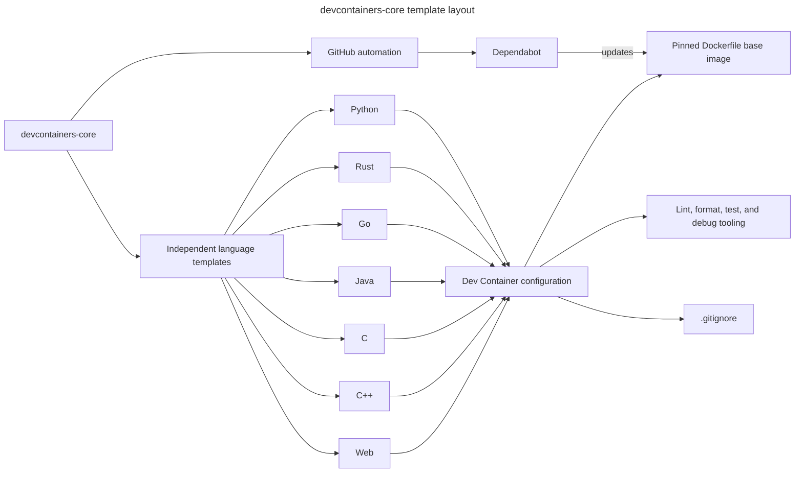

# INSTALL.md - devcontainers-core

Technical vision and installation guide.

## Vision

Ready-to-use development container templates for fast project starts.

`devcontainers-core` is a public GitHub repository of independently copyable,
language-specific starter directories. Each directory gives an individual
developer a reproducible Dev Container, practical quality tooling, testing,
debugging, and a focused `.gitignore` without imposing an application
architecture or a team workflow.

The repository supports Python, Rust, Go, Java, C, C++, and web projects. The
configuration is portable across Dev Container-compatible editors on Linux,
macOS, and Windows. Editor-specific enhancements must remain optional.

## Decisions

| Decision | Choice | Why |
| --- | --- | --- |
| Architecture | Static monorepo of independent language templates | A developer can copy exactly one directory and begin immediately. |
| Front-end | Not applicable | This repository distributes development environments, not a web application. |
| Back-end | Not applicable | This repository has no hosted runtime or API. |
| Database | Not applicable | The templates do not require a shared data store. |
| Auth | Not applicable | Public GitHub access is sufficient for the repository itself. |
| Hosting | Public GitHub repository | It meets the zero-budget requirement and supports Dependabot and pull requests. |
| Container images | A Dockerfile in every template, with a version-and-digest-pinned base image | A digest makes the image content reproducible; a Dockerfile lets Dependabot's Docker updater detect the base image. |
| Dependency updates | Dependabot pull requests, reviewed manually | Updates remain visible and testable; no unreviewed image change reaches users. |

## Stack summary

- **Dev Container:** the open Dev Container specification; every template has
  `.devcontainer/devcontainer.json` and `.devcontainer/Dockerfile`.
- **Image policy:** never use `latest`. Pin `FROM` to `image:version@sha256:...`.
  Resolve and commit the exact digest during template implementation.
- **Python:** CPython, `venv`, Ruff for linting and formatting, pytest for tests,
  and debugpy for debugging.
- **Rust:** the Rust toolchain, Cargo, rustfmt, Clippy, Cargo tests,
  rust-analyzer, and CodeLLDB or GDB for debugging.
- **Go:** the Go toolchain, `gofmt`, `go vet`, `go test`, and Delve.
- **C:** CMake, CTest, compiler warnings, cppcheck, clang-format, and GDB.
- **C++:** CMake, CTest, compiler warnings, clang-tidy, clang-format, and GDB.
- **Java:** JDK 21, Maven Wrapper, JUnit 5, the Java formatter, and the Java
  debugger. A template must not install an unpinned global Maven or Gradle.
- **Web:** Bun for package management, scripts, and tests; Biome for JavaScript,
  TypeScript, JSON, CSS, and supported HTML formatting and linting. Node and
  Deno are not included in the default web template.
- **Key integrations:** GitHub Dependabot, public container registries, and
  Dev Container-compatible editors.

## Architecture

Each language directory is a standalone boundary: copying it does not require
any shared repository package or registry-owned feature. Its Dockerfile owns
the immutable base-image reference, while `devcontainer.json` supplies the
portable development-environment settings.

Dependabot proposes Dockerfile updates as pull requests. Maintainers verify a
rebuild and the language quality commands before merging, so a template update
never changes a consumer's already-copied project automatically.



## Folder structure

```txt
devcontainers-core/
|-- .github/
|   `-- dependabot.yml
|-- aidd_docs/
|   `-- INSTALL.md
|-- python/
|   |-- .devcontainer/
|   |   |-- devcontainer.json
|   |   `-- Dockerfile
|   |-- .gitignore
|   |-- pyproject.toml
|   `-- README.md
|-- rust/
|   |-- .devcontainer/
|   |-- .gitignore
|   |-- Cargo.toml
|   `-- README.md
|-- go/
|   |-- .devcontainer/
|   |-- .gitignore
|   |-- go.mod
|   `-- README.md
|-- java/
|   |-- .devcontainer/
|   |-- .gitignore
|   |-- pom.xml
|   |-- mvnw
|   `-- README.md
|-- c/
|   |-- .devcontainer/
|   |-- .gitignore
|   |-- CMakeLists.txt
|   |-- CMakePresets.json
|   `-- README.md
|-- cpp/
|   |-- .devcontainer/
|   |-- .gitignore
|   |-- CMakeLists.txt
|   |-- CMakePresets.json
|   `-- README.md
|-- web/
|   |-- .devcontainer/
|   |-- .gitignore
|   |-- biome.json
|   |-- package.json
|   |-- bun.lock
|   `-- README.md
`-- README.md
```

Each language README documents the editor-agnostic commands, required base-image
pin, available debug mode, and the intentional exclusions from that template.
Language-specific editor extensions belong under `customizations` and must not
be required for the container to build or for command-line tooling to work.

## Install steps

1. Create the public GitHub repository named `devcontainers-core` and clone it.
2. Add `.github/dependabot.yml` with the Docker update ecosystem and a manual
   pull-request review policy.
3. Create one language directory at a time, starting with its `.devcontainer`
   directory and Dockerfile.
4. Select a supported base-image version, resolve its immutable digest, and
   commit both in the Dockerfile. Do not use `latest`.
5. Add the language's configuration files and quality commands from the stack
   summary, then rebuild the Dev Container in a compatible editor.
6. Run formatting, linting, tests, and a debugger smoke test inside the rebuilt
   container before accepting a Dependabot update or publishing the template.

## Audit summary

| Candidate | Verdict | Notes |
| --- | --- | --- |
| Static monorepo of templates | Warning accepted | Best fit for copy-one-directory use; direct `devcontainer.json` image references were replaced by Dockerfile base-image pins so Dependabot can update them. |
| Templates with shared Dev Container Features | Rejected | Digest-pinned Features are not currently updated by Dependabot, adding manual registry maintenance. |
| Separate repositories per language | Warning | Technically viable but multiplies configuration, validation, release, and discovery work. |

## References

- [Dev Container specification](https://containers.dev/implementors/spec/)
- [Docker base-image pinning guidance](https://docs.docker.com/build/building/best-practices/#pin-base-image-versions)
- [Dependabot options reference](https://docs.github.com/en/code-security/dependabot/working-with-dependabot/dependabot-options-reference)
- [Bun documentation](https://bun.sh/docs/)
- [Biome documentation](https://biomejs.dev/guides/getting-started/)
- [Ruff documentation](https://docs.astral.sh/ruff/)
- [Cargo documentation](https://doc.rust-lang.org/cargo/)
- [Go documentation](https://go.dev/doc/)
- [CMake presets documentation](https://cmake.org/cmake/help/latest/manual/cmake-presets.7.html)
- [Maven Wrapper documentation](https://maven.apache.org/wrapper/)
