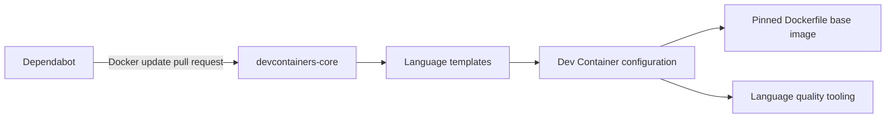

# Architecture

## Stack

- Dev Containers provide portable development environments across compatible editors.
- Every language template owns its Dockerfile, `.devcontainer` configuration, language tooling, and `.gitignore`.
- Bun and Biome are the web-template runtime and quality-tool defaults.

## How it fits together

## Key decisions

- Templates are independent directories so users copy one language without inheriting a shared framework.
- Dockerfiles pin base images by version and digest; `latest` is forbidden.
- Dependabot proposes Dockerfile updates for manual rebuild, test, and review.

## Gotchas

- A direct `image` reference in `devcontainer.json` does not provide the required Dependabot Docker-update workflow; keep the base image in the template Dockerfile.
- Native debugging may need extra container privileges and must remain opt-in per language template.
