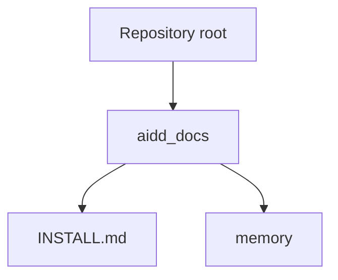

# Codebase Map

## Areas

- `aidd_docs/`: the confirmed repository design and project memory.
- `aidd_docs/memory/`: durable context for AI-assisted work.

## Entry points

- There is no runnable template yet; `aidd_docs/INSTALL.md` is the current implementation guide.
