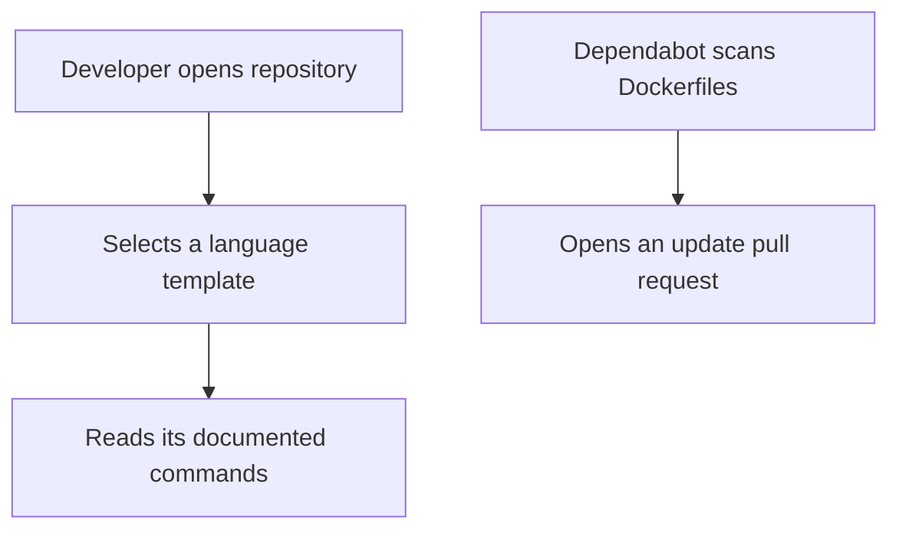
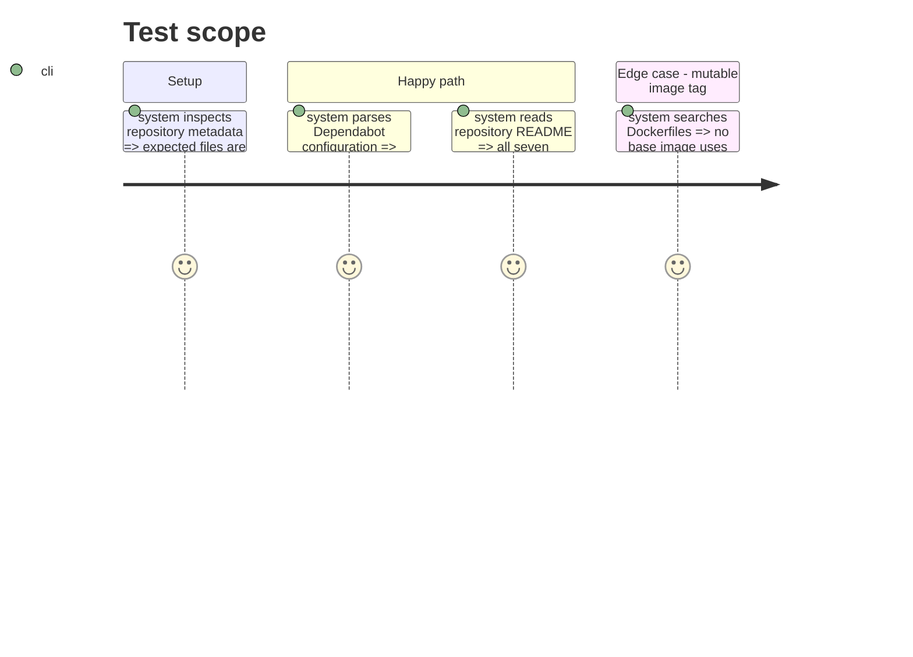

# Instruction: Repository foundation

## Architecture projection

> Tree of the final files. ✅ create

```txt
.
|-- .github/
|   `-- dependabot.yml
`-- README.md
```

## User Journey



## Test Scope



## Tasks to do

### `1)` Add repository entry points

> Make all templates discoverable and image updates reviewable.

1. Add a root README that explains the copy-one-directory model and links every template.
2. Configure weekly Dependabot Docker updates for every template directory.
3. Document manual review and container validation before image-update merges.

## Test acceptance criteria

| Task | Acceptance criteria |
| --- | --- |
| 1 | The root README links Python, Rust, Go, Java, C, C++, and web templates. |
| 2 | Dependabot declares a valid Docker update configuration for each Dockerfile directory. |
| 3 | Repository documentation requires a rebuilt-container quality check before merging image updates. |
