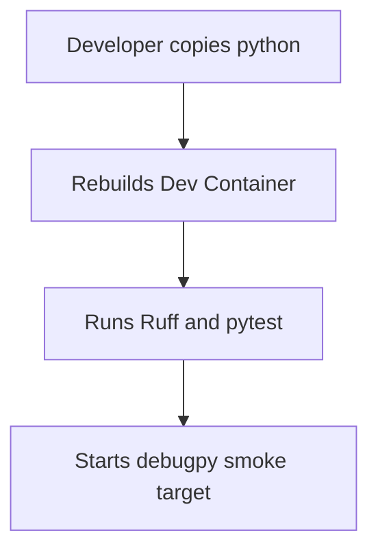
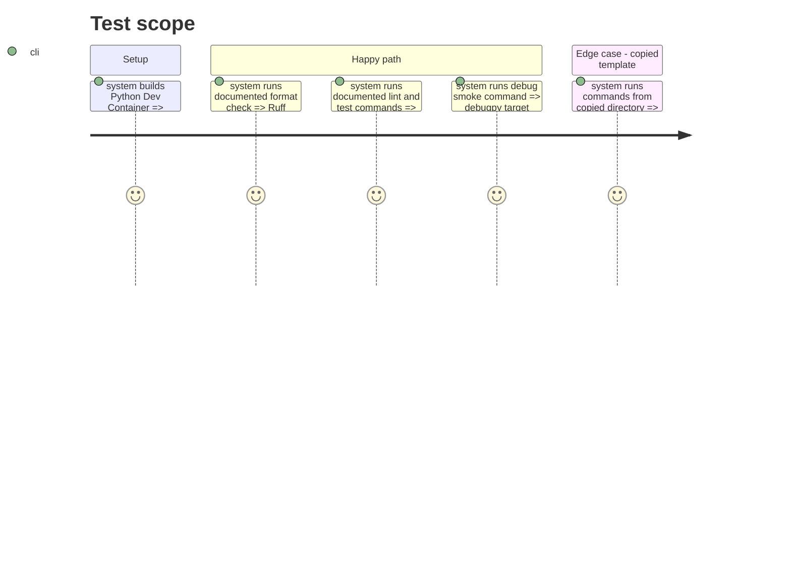

# Instruction: Python template

## Architecture projection

> Tree of the final files. ✅ create

```txt
python/
|-- .devcontainer/
|   |-- devcontainer.json
|   `-- Dockerfile
|-- .gitignore
|-- pyproject.toml
|-- README.md
`-- tests/
    `-- test_smoke.py
```

## User Journey



## Test Scope



## Tasks to do

### `1)` Build the Python environment

> Supply CPython, isolated dependencies, quality tooling, tests, and debugging.

1. Resolve and pin a supported Python base image by version and digest.
2. Add Dev Container configuration, project metadata, sample test, ignore rules, and documented commands.
3. Configure Ruff, pytest, and debugpy in the container and project files.

## Test acceptance criteria

| Task | Acceptance criteria |
| --- | --- |
| 1 | The Python Dockerfile uses a version-and-digest-pinned base image. |
| 2 | The rebuilt container runs documented formatting, linting, test, and debug smoke commands. |
| 3 | The copied Python directory has no repository-level runtime dependency. |
