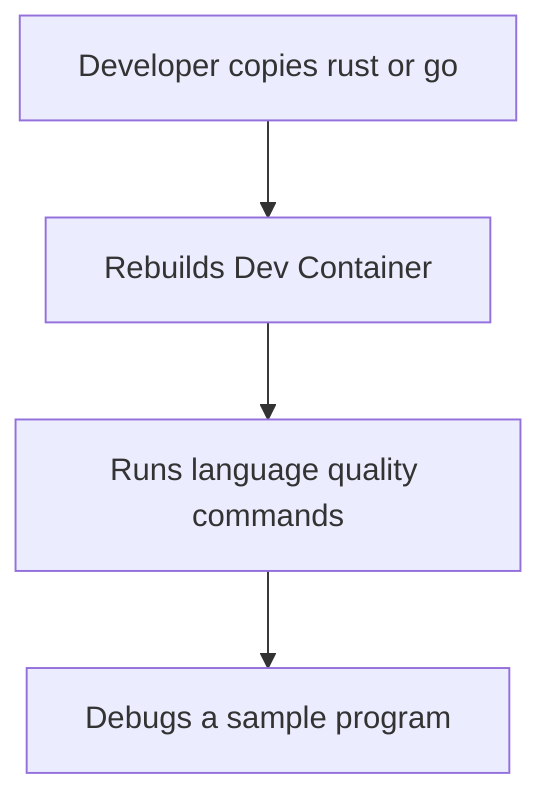
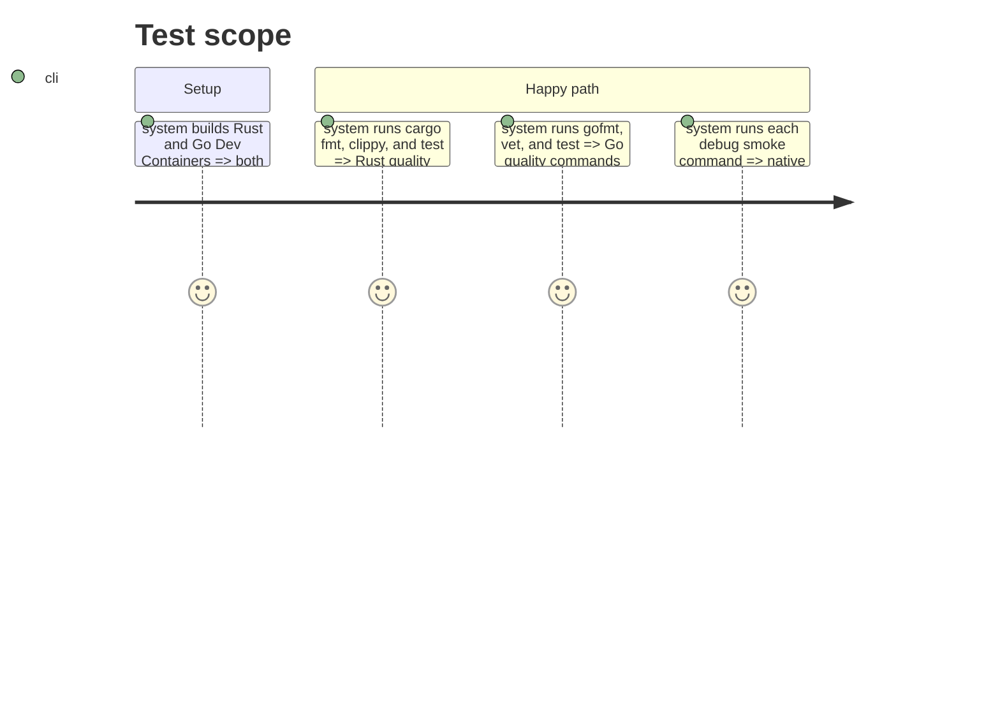

# Instruction: Rust and Go templates

## Architecture projection

> Tree of the final files. ✅ create

```txt
rust/
|-- .devcontainer/
|-- .gitignore
|-- Cargo.toml
`-- README.md
go/
|-- .devcontainer/
|-- .gitignore
|-- go.mod
`-- README.md
```

## User Journey



## Test Scope



## Tasks to do

### `1)` Build Rust and Go environments

> Provide self-contained compiled-language templates with their native quality tools.

1. Create Rust files for Cargo, rustfmt, Clippy, tests, rust-analyzer, and debugger configuration.
2. Create Go files for gofmt, vet, tests, Delve, and debugger configuration.
3. Pin both base images and document all commands and intentional exclusions.

## Test acceptance criteria

| Task | Acceptance criteria |
| --- | --- |
| 1 | Rust passes its documented format, lint, test, and debug smoke commands in its rebuilt container. |
| 2 | Go passes its documented format, vet, test, and debug smoke commands in its rebuilt container. |
| 3 | Both Dockerfiles pin a version and SHA-256 digest, and debugging privileges are only enabled when needed. |
