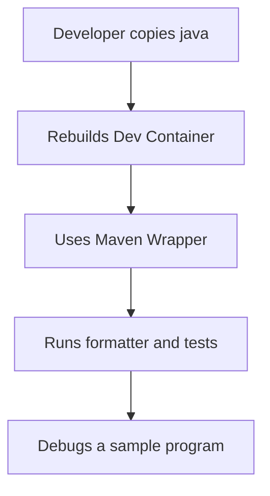
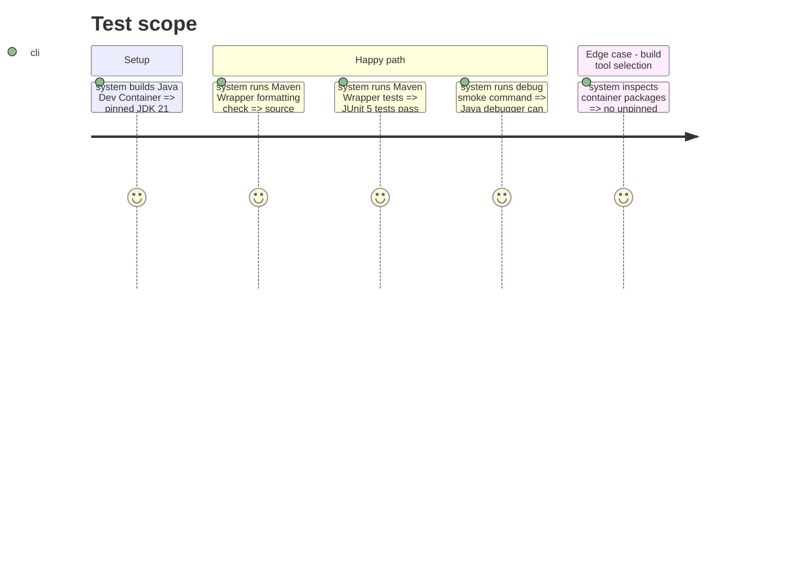

# Instruction: Java template

## Architecture projection

> Tree of the final files. ✅ create

```txt
java/
|-- .devcontainer/
|-- .gitignore
|-- .mvn/
|-- mvnw
|-- pom.xml
`-- README.md
```

## User Journey



## Test Scope



## Tasks to do

### `1)` Build the Java environment

> Supply a JDK 21 template that uses the project-owned Maven Wrapper.

1. Resolve and pin the JDK base image, then configure the Dev Container and Java debugger.
2. Add Maven Wrapper, Maven project configuration, JUnit 5, formatter, ignore rules, and a sample test.
3. Document rebuild, quality, test, and debug commands without requiring globally installed Maven or Gradle.

## Test acceptance criteria

| Task | Acceptance criteria |
| --- | --- |
| 1 | The Java template builds with a version-and-digest-pinned JDK 21 image. |
| 2 | Maven Wrapper runs the documented formatting and JUnit test commands in the container. |
| 3 | The template does not install an unpinned global Maven or Gradle. |
