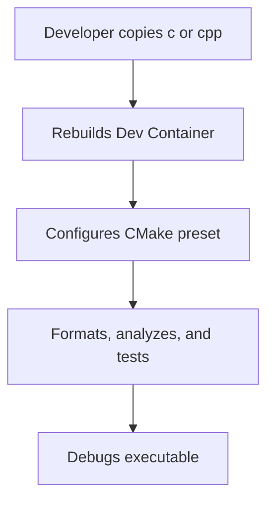
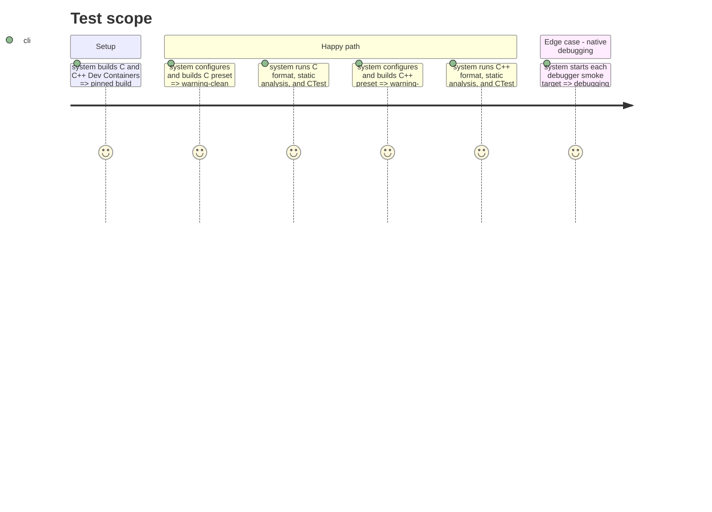

# Instruction: C and C++ templates

## Architecture projection

> Tree of the final files. ✅ create

```txt
c/
|-- .devcontainer/
|-- .gitignore
|-- CMakeLists.txt
|-- CMakePresets.json
`-- README.md
cpp/
|-- .devcontainer/
|-- .gitignore
|-- CMakeLists.txt
|-- CMakePresets.json
`-- README.md
```

## User Journey



## Test Scope



## Tasks to do

### `1)` Build C and C++ environments

> Provide CMake-based native templates with compiler warnings, analysis, testing, and debugging.

1. Create pinned Dockerfiles and Dev Container settings with opt-in ptrace support.
2. Add CMake projects, presets, sample sources and tests, ignore rules, and READMEs for C and C++.
3. Configure C with cppcheck and clang-format, and C++ with clang-tidy and clang-format.

## Test acceptance criteria

| Task | Acceptance criteria |
| --- | --- |
| 1 | C and C++ configure, build, and run CTest through their documented presets. |
| 2 | Each template runs its required formatter and static analyzer with a clean sample project. |
| 3 | Both templates use version-and-digest-pinned images and narrowly scoped debugger permissions. |
