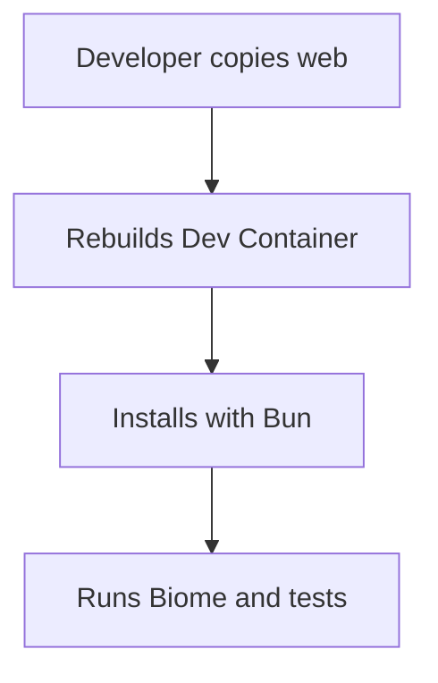
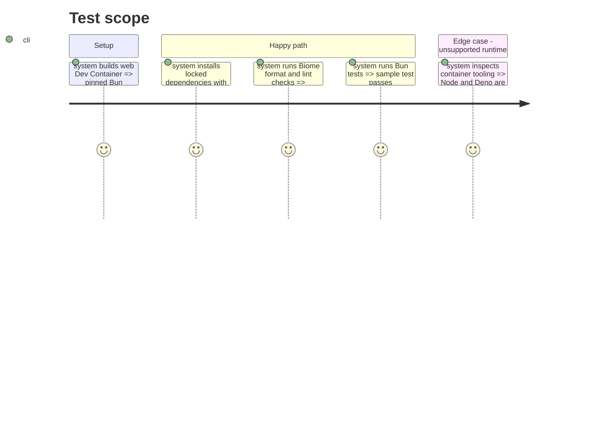

# Instruction: Web template

## Architecture projection

> Tree of the final files. ✅ create

```txt
web/
|-- .devcontainer/
|-- .gitignore
|-- biome.json
|-- bun.lock
|-- package.json
`-- README.md
```

## User Journey



## Test Scope



## Tasks to do

### `1)` Build the web environment

> Provide a Bun-only web template with Biome quality checks and tests.

1. Resolve and pin a Bun base image, then create Dev Container configuration.
2. Add package metadata, locked dependencies, Biome configuration, sample test, ignore rules, and README.
3. Document Bun install, format, lint, test, and debugging workflow and state that Node and Deno are excluded.

## Test acceptance criteria

| Task | Acceptance criteria |
| --- | --- |
| 1 | The web Dockerfile uses a version-and-digest-pinned Bun image. |
| 2 | Bun runs the documented locked install, Biome checks, and test command in the rebuilt container. |
| 3 | The default web template contains neither Node nor Deno. |
